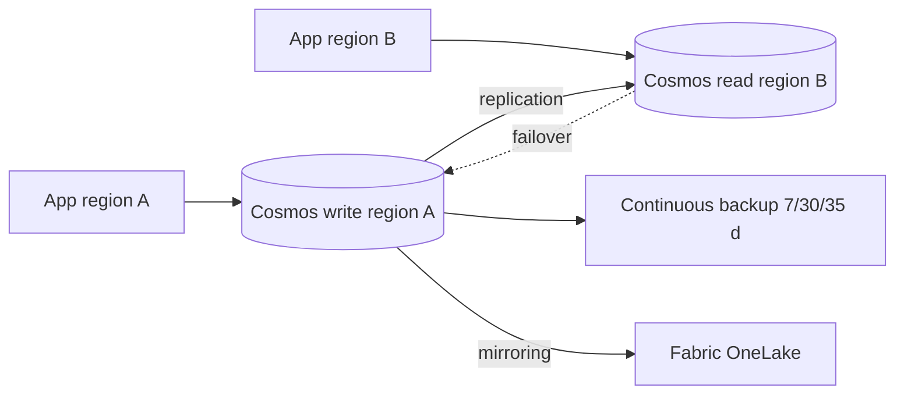

# Cosmos DB: consistency, global distribution, resiliency and backup

Last verified: 2026-10-19. Source: Microsoft Learn `consistency-levels` (2026-04-27), `high-availability` / `azure/reliability/reliability-cosmos-db` (2026-09-30), `distribute-data-globally` (2026-06-15), `how-to-configure-per-partition-automatic-failover` (2026-08-10), `nosql/how-to-multi-master` (2026-04-27), `conflict-resolution-policies` (2026-04-27), `online-backup-and-restore` (2026-08-27), `continuous-backup-restore-introduction` (2026-08-27), `periodic-backup-restore-introduction` (2026-04-27), Well-Architected Cosmos DB service guide (2026-07-30). The SLA document, the multi-region-writes page and RTO figures were not retrieved.

## 1. Consistency levels
| Level | Guarantee | Cost and behaviour | Multi-region writes |
|---|---|---|---|
| **Strong** | Linearizable | Reads from a local minority quorum (2 of 4 replicas) so read RU about 2x; writes need a global majority; multi-region write latency about 2x RTT between the two farthest regions plus 10 ms p99; across regions more than 5,000 miles (8,000 km) apart blocked by default (contact support) | **Not available** |
| **Bounded staleness** | Lag bounded by K versions or T time | Reads from 2 replicas so about 2x RU; writes throttled if cross-region lag exceeds the bound; minimum K,T 10 writes / 5 s single region, 100,000 writes / 300 s multi-region | Available; page calls it an anti-pattern there |
| **Session** | Read-your-writes and write-follows-reads within a session token | Single-replica reads; latency and throughput comparable to eventual; **most widely used** | Available |
| **Consistent prefix** | No out-of-order reads; transactional batches visible together | Single-replica reads | Available |
| **Eventual** | No ordering guarantee | Lowest read RU | Available |

Read and write p99 latency is under 10 ms for all levels except multi-region Strong writes. Write RU cost is identical across levels. Default to Session; escalate only for flows that demonstrably need more, and price the 2x read cost.

## 2. RPO by configuration (Learn)
| Regions | Write mode | Consistency | RPO |
|---|---|---|---|
| 1 | any | any | under 240 minutes |
| more than 1 | single write | Session / Consistent prefix / Eventual | under 15 minutes |
| more than 1 | single write | Bounded staleness | K and T |
| more than 1 | single write | Strong | 0 |
| more than 1 | multi-write | Session / Consistent prefix / Eventual | under 15 minutes |
| more than 1 | multi-write | Bounded staleness | K and T |

Strong is excluded from multi-write because a distributed system cannot give RPO 0 and RTO 0 together. RTO numbers: `UNVERIFIED` (not on the fetched pages).

## 3. Availability and SLA
- **99.999%** read and write availability is stated for multi-region accounts. The 99.99% and 99.995% figures for single-region, zone-redundant and multi-read configurations are `UNVERIFIED` (the SLA document at `aka.ms/CSLA` was not fetched).
- **Zone redundancy**: configured per region; serverless accounts can enable it only at creation; zone failure expects no data loss and a few seconds of downtime; the premium is waived for multi-region-write accounts and autoscale containers; a single-region zone-redundant account still loses access if multiple zones or the region fail.
- **Service-managed failover**: follows region priority order; declaring the outage "can take significant time, potentially one hour or more"; unreplicated writes may be lost unless Strong; a recovered region is not auto-promoted back; region recovery can take several days. **Forced failover** (customer-triggered) usually takes seconds and can lose unreplicated writes. Changing the write region has no data loss but needs healthy regions and must not be used during an outage.
- **Per-partition automatic failover (PPAF)**: single-write accounts with at least one more read region, NoSQL only; Strong, Session, Consistent prefix, Eventual supported (Bounded staleness "in a future release"); minimum SDKs .NET 3.62.0, Java 4.79.0, Python 4.16.0, Node.js 4.7.0; part of the Business Critical tier and charged accordingly; failover about 3 minutes; unreplicated data can be lost unless Strong; **GA vs preview not stated: `UNVERIFIED`**.

## 4. Multi-region writes
Enabling on an existing single-write account has zero downtime; set `ApplicationRegion` or `PreferredRegions` in the SDK; unreplicated writes can be read from the conflict feed. Use when clients are globally distributed and you can tolerate conflict handling and weaker consistency.
- **Conflict resolution**: conflict types insert, replace, delete. **Last Write Wins** is the default (timestamp `_ts` by default, NoSQL can use a custom numeric path; highest wins; delete always wins). **Custom** uses a merge stored procedure; unresolved conflicts or procedure exceptions go to the conflicts feed; NoSQL only; **set at container creation only**.

## 5. Backup and restore
| | Continuous | Periodic (default) |
|---|---|---|
| Tiers | **7, 30 and 35 days** | Full backup every 4 hours, latest 2 copies kept (configurable; min interval 1 hour; retention up to about a month) |
| Cost | 7-day tier has no backup storage charge; 30 and 35 day tiers about $0.20/GB/region/month (West US example); restore about $0.15/GB per restore (West US example) | Two copies free |
| Restore | Self-service, point in time, always to a new account (or in-account for containers/databases); same subscription; only regions where the source existed; not into an account with fewer partitions or lower RU/s | By support request into a new single-region account |
| Not restored | Firewall, VNet, RBAC and private endpoint settings, regions, stored procedures, triggers, UDFs, RBAC assignments; analytical store not backed up; TTL is re-applied so use `--disable-ttl True`; multi-write restore resets conflict resolution to LWW | Materialized views, TTL-expired documents, analytical store |
| Notes | Mutations backed up within about 100 s; storage locally redundant or zone redundant where available (not changeable); **cannot switch from continuous back to periodic**; Cassandra API not supported; not geo-disaster resistant unless you add a region | Stored in the write region's Blob storage, GRS to the paired region; deleted containers/databases keep snapshots 30 days |

RPO/RTO of backups: no numbers on the pages: `UNVERIFIED`. Price examples are illustrative; check the pricing page.

## 6. Well-Architected checklist (Learn guide)
**Reliability**: simple design, avoid multi-write and custom indexing unless needed, failure mode analysis, always use the SDK with retries, at least 2 regions plus availability zones, single-write accounts keep a read region and enable service-managed failover, consider consistency effect on RPO, test failover and failback end to end (temporarily disable service-managed failover for the test), continuous backup sized to requirements, validate partition-level failover.
**Operational excellence**: monitor all regions with a user-agent suffix per workload, alert on throttling (normalized RU), size and host CPU/memory, IaC (ARM, Bicep, Terraform), latest SDK, supplemental diagnostics, query metrics, emulator in CI.
**Azure Policy checks**: at least 2 regions, zone redundancy, local auth disabled, public network access disabled.

## 7. Reference architecture

## 8. Anti-patterns
- Strong consistency "to be safe" on a global account (2x read RU and no multi-write).
- Multi-region writes with no conflict policy decision.
- Service-managed failover as the only plan (it can take an hour or more to declare).
- Never testing a restore; assuming restore recreates firewall and RBAC.
- Switching to the 30 or 35 day tier without costing storage.
- Counting on zone redundancy for regional outages.

## 9. Talk track
"Pick the consistency per flow, not per account: Session for almost everything, Strong only where the business loses money on a stale read, and then we accept single-write. For resiliency we add a second region, enable automatic failover, and rehearse a forced failover because the automatic path can take an hour."
