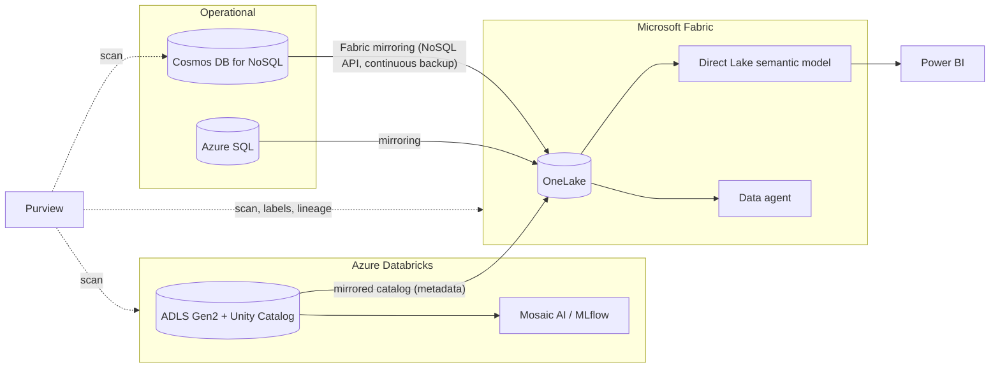
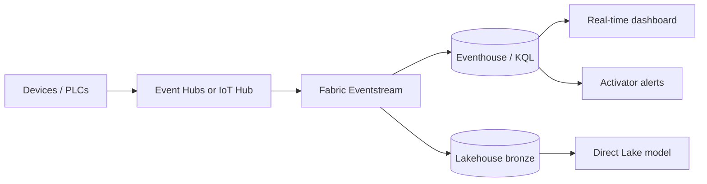
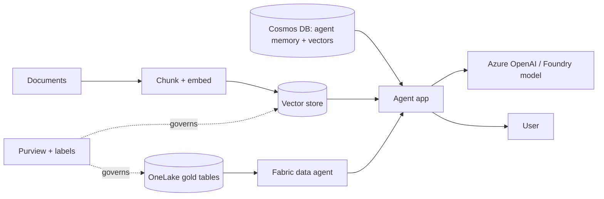
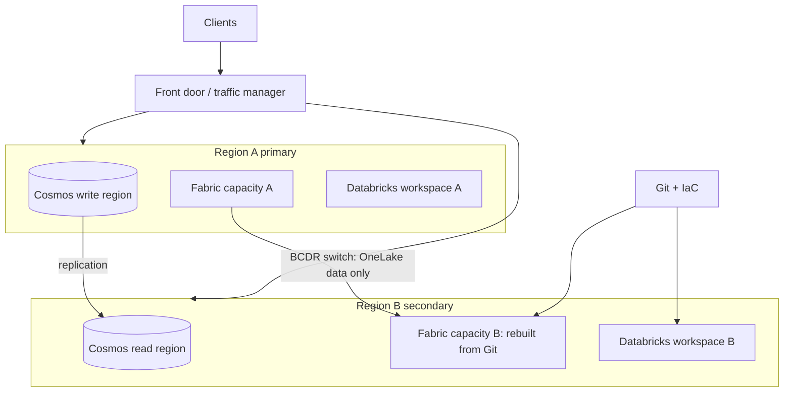
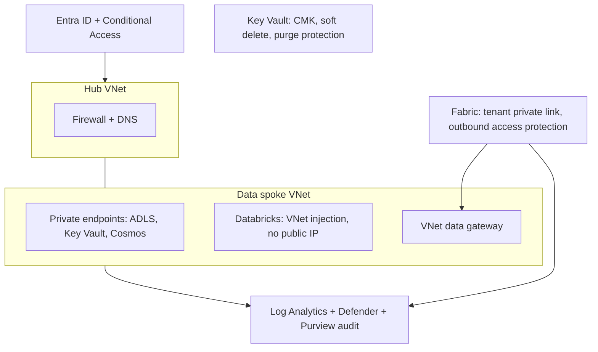

# Reference architectures (Mermaid)

Last verified: 2026-10-19. These are design patterns built from Learn-verified capabilities; they are not official Microsoft diagrams. Preview items are flagged. Labels containing parentheses are quoted so Mermaid renders them.

## 1. Modern data estate: Fabric + Databricks + Cosmos DB + Purview

Use when: operational data feeds analytics and AI, with Databricks for engineering/ML. Trade-off: two compute platforms mean two security models; pick one owner for row/column security. Synapse Link for Cosmos DB is not supported for new projects (Learn); use Fabric mirroring.

## 2. Real-time / IoT

Use when: second-level telemetry, anomaly alerting. Trade-off: Eventhouse is the only Fabric store where OneLake availability is opt-in; Real-Time Intelligence skips the interactive-delay throttling stage and begins rejecting at the 60-minute stage; keep streaming on its own capacity.

## 3. RAG / agentic AI over operational and analytical data

Vector choices (Learn): Cosmos DB NoSQL offers `flat` (max 505 dims), `quantizedFlat` and `diskANN` (max 4096 dims); Eventhouse stores vectors without a native ANN index; SQL database in Fabric vector status is `UNVERIFIED`. Data agent limits: 5 sources, 25 rows/columns per response, read-only. Keep preview items (ontology, Foundry tools in Fabric) out of the critical path.

## 4. Multi-region DR

Use when: tier 1/2 workloads. Trade-off: Fabric BCDR covers OneLake lakehouse and warehouse data only; KQL, notebooks, pipelines and the rest are rebuilt from Git; Fabric replication is asynchronous with no published numeric RPO.

## 5. Regulated-industry landing zone (FSI, healthcare)

Notes: Fabric private link breaks on-prem gateway registration (VNet data gateway works) and starter Spark pools, and does not secure outbound traffic; trusted workspace access is for F SKUs and not for Spark (use managed private endpoints); Cosmos DB customer-managed keys need Key Vault with soft delete and purge protection and a vault reachable by public access or the trusted-services bypass. Databricks networking facts: see the `azure-databricks-architecture` skill (VNet injection, SCC, Private Link, storage firewall).
