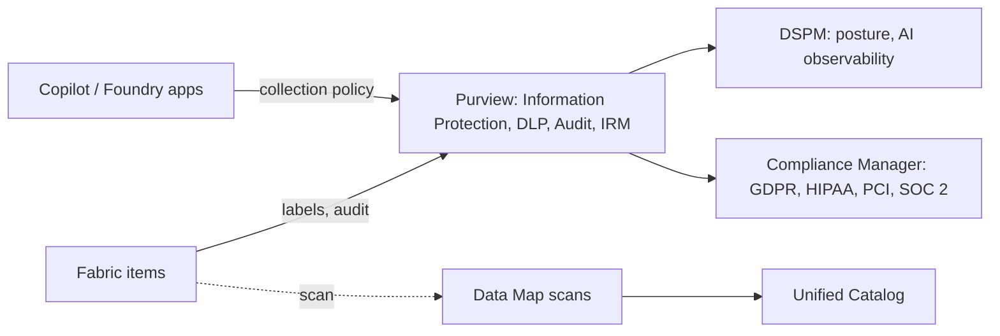

# Purview: Fabric integration, AI governance, compliance and automation

Last verified: 2026-10-20. Source: Microsoft Learn `fabric/governance/microsoft-purview-fabric` (2026-09-29), `purview/data-security-posture-management-learn-about` (2026-06-25), `purview/dspm-for-ai` and `dspm-for-ai-considerations` (2026-06-25), `purview/ai-microsoft-purview` (2026-06-25), `purview/compliance-manager-regulations-list` (2026-06-25), `purview/purview-permissions` (2026-08-28). Four pages returned 404 (Fabric protection policies, Data Map data residency, REST API overview, Terraform/Bicep connect overview) and several linked pages were not read. Those areas are `UNVERIFIED` below.

## 1. Fabric and Purview: who does what
- Native Fabric governance (OneLake catalog, Govern) stays in Fabric. Purview adds: **Information Protection** (sensitivity labels on all Fabric items, protection survives supported exports), **DLP** for structured Fabric data (lakehouses, warehouses, databases, semantic models; evaluates labels and sensitive info types, policy tips and alerts), **Audit** (all Fabric user activities in the Purview audit log), **Insider Risk Management** (Fabric indicators), and governance and risk controls for Fabric Copilots and agents.
- The page states no licence, role or GA/preview status for these: `UNVERIFIED`.
- Data security posture for Fabric (data risk assessments): needs an Entra app registration (federated credentials recommended) in a security group; Fabric admin must enable "Service principals can access read-only admin APIs" and "...admin APIs used for updates" for that group; setup roles Cloud Application Administrator, Application Administrator or Privileged Role Administrator plus Fabric administrator. Default weekly assessment covers the top 100 Fabric workspaces; item types Dashboard, Report, DataExploration, DataPipeline, KQLQuerySet, Lakehouse, Notebook, SQLAnalyticsEndpoint, Warehouse.
- Sensitivity label behaviour in Fabric (inheritance direction, export enforcement, what labels do not block) is in the Fabric security-governance reference.
- Fabric protection policies: page returned 404; `UNVERIFIED`.

## 2. Posture management for data and AI (DSPM)
- Current DSPM (Solutions, DSPM) covers AI apps and agents plus Microsoft 365, Azure, Fabric and third-party sources; non-Microsoft sources via the Microsoft Sentinel data lake are "in preview". The overview page also says DSPM is "Now in preview". Classic **DSPM for AI** says it will not be extended and points to the new DSPM.
- Roles: Entra Compliance Administrator or the Purview Compliance Administrator role group.
- Classic DSPM for AI facts: weekly data risk assessment on the top 100 SharePoint sites; custom assessments in preview; item-level scan limits 200,000 items per location, OneDrive not supported, max 10 SharePoint sites; policies take at least 24 hours to show data.
- Prerequisites: auditing on (default for new tenants); M365 Copilot licence for Copilot monitoring; **Copilot in Fabric and Security Copilot need "the enterprise version of Microsoft Purview data governance" plus a collection policy**; Edge configuration policy for Edge DLP; device onboarding and the Purview browser extension for third-party gen-AI sites; Entra-registered AI apps integrated with the Purview SDK; **pay-as-you-go billing for AI apps other than M365 Copilot and Facilitator**.
- One-click policies (names exact): DLP "DSPM for AI: Detect sensitive info added to AI sites" (audit only), "DSPM for AI - Block sensitive info from AI sites" (test mode), "DSPM for AI - Protect sensitive data from Copilot processing"; Insider Risk "DSPM for AI - Detect risky AI usage"; Communication Compliance "DSPM for AI - Unethical behavior in AI apps"; collection policies "Capture interactions for Copilot experiences", "...for enterprise AI apps" and "Detect sensitive info shared with AI via network" (needs manual SASE/SSE integration). Restricted administrative-unit admins cannot create all-user one-click policies.

## 3. Governing AI apps
Covered categories (sub-pages not read): M365 Copilot and Chat, Copilot Cowork, Security Copilot, Copilot in Fabric, Copilot Studio, Microsoft Facilitator, Teams channel agent, Entra-registered apps, Microsoft Foundry, ChatGPT Enterprise, Anthropic Claude (Enterprise), other AI apps.
- **Labels and Copilot**: Copilot honours encryption only when the user has VIEW and EXTRACT usage rights; unencrypted labelled files need no extra step.
- DLP: endpoint DLP can block paste to third-party gen-AI sites on onboarded Windows devices. IRM has a "Risky AI usage" template (prompt injection, protected materials). Audit captures prompts and responses in the unified audit log. Communication compliance detects sensitive info types in prompts and responses. eDiscovery finds Copilot prompts via the "Copilot activity" condition (prompts stored in the user mailbox). Retention policies for prompts and responses: page not read.
- Purview SDK for custom AI apps: referenced, API names `UNVERIFIED`.
- Fabric Copilot data handling and cross-geo settings are in the Fabric AI-readiness reference.

## 4. Compliance Manager templates
Included: Microsoft Data Protection Baseline for all subscriptions; A5/E5/G5 get any three premium regulations free; GCC Moderate/High/DoD get CMMC levels 1 to 5. Templates named: EU GDPR, HIPAA/HITECH, PCI DSS v3.2.1 and v4.0, SOC 2 (and SOC 1), EU Artificial Intelligence Act, ISO/IEC 42001:2023, NIST AI RMF 1.0. The page does not describe what a template does *not* do; the safe framing is that a template provides a control checklist and assessment workflow, not certification (assessment detail `UNVERIFIED`).

## 5. RBAC for compliance solutions
Role groups are managed in Settings, Roles and scopes; managing them needs the Role Management role or Global Administrator. Temporary assignments last 1 day to 2 years (not for eDiscovery Administrator or Manager). Mapping examples: AI Administrator maps to Compliance Manager Administrators and Data Security AI Admins/Viewers; Compliance Administrator maps to Compliance Administrator. See governance-operating-model for the catalog roles.

## 6. Data residency, automation, licensing (gaps)
| Topic | Status |
|---|---|
| Where Data Map and Unified Catalog data reside, region list | `UNVERIFIED` (residency page 404) |
| Purview REST and Atlas-compatible APIs, Python SDK status/deprecation | `UNVERIFIED` (overview 404) |
| Terraform `azurerm_purview_account`, Bicep `Microsoft.Purview/accounts` | `UNVERIFIED`; resource type names are well known but the doc page was not retrieved. Confirm on Learn before scripting |
| CI/CD for glossary and policies | not researched |
| E5 / E5 Compliance prerequisites and DSPM pay-as-you-go pricing | `UNVERIFIED` (service description not read) |

Do not promise an automation approach or a residency answer to a customer until these are checked.

## 7. Anti-patterns
- Turning on one-click DLP in block mode on day one (audit/test first).
- Expecting labels to stop CSV exports or cross-tenant sharing (see Fabric reference).
- Assuming Copilot in Fabric governance works without the enterprise governance plan and a collection policy.
- Treating DSPM for AI classic and the new DSPM as the same product.

## 8. Reference architecture

## 9. Talk track
"For AI, the first control is knowing where sensitive data is and which labels protect it. We start in audit and test mode, capture AI interactions with a collection policy, and only then tighten DLP. I will confirm licensing and residency before we commit, because those pages are the ones I have not been able to verify."
