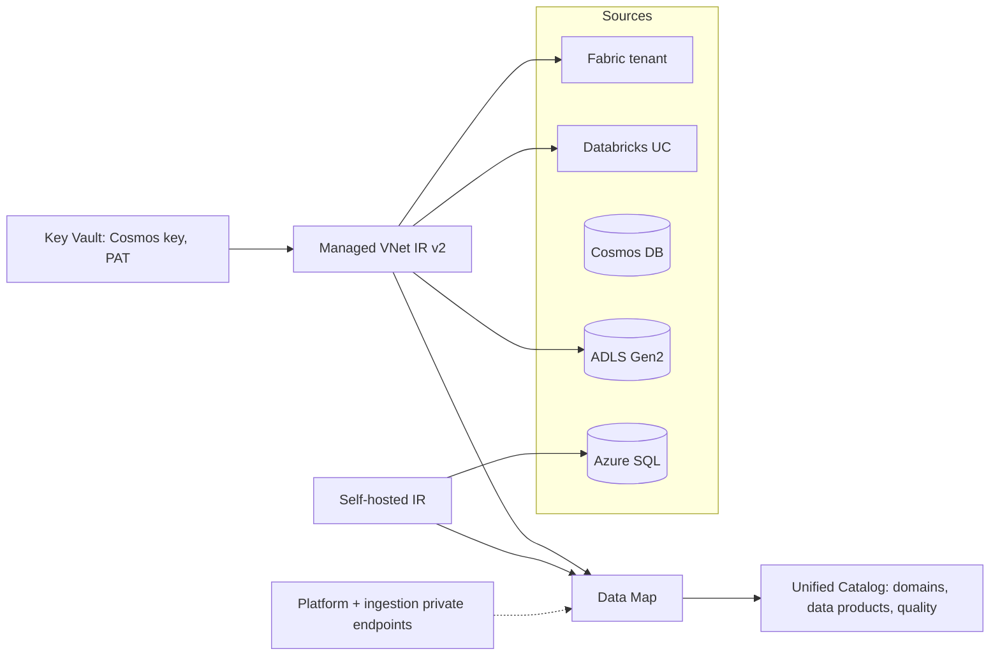

# Purview: scanning, lineage and networking

Last verified: 2026-10-20. Source: Microsoft Learn `purview/data-map-data-sources` (2026-07-01), per-source register-and-scan pages (updated 2026-06-01 to 2026-07-31), `data-map-integration-runtime-choose` (2026-05-15), `data-governance-private-endpoints-managed-virtual-network` (2026-06-01), `data-governance-private-endpoints` (2025-11-18), `data-map-lineage-azure-data-factory` (2026-06-01), `data-map-scan-rule-set` (2025-12-09), `data-map-scan-ingestion`, classic quota page (2025-12-16). Where two pages disagree it is called out. API rate limits: the best-practices-limits page returned 404, so **no rate numbers are verified**.

## 1. Source capability matrix
| Source | Classification | Labels | Access policies | Lineage | Live view |
|---|---|---|---|---|---|
| Microsoft Fabric | No | No | No | Yes (item level) | Yes (same tenant) |
| Azure Databricks Unity Catalog | Yes (no custom classification) | No | No | Yes | No |
| Azure Cosmos DB (NoSQL/SQL API) | Yes | Yes | No | No on its own; yes as source/sink in ADF or Synapse pipelines | No |
| ADLS Gen2 | Yes | Yes | Yes (PREVIEW) | Limited | Yes |
| Azure SQL Database | Yes | Yes | Yes (protection policies not supported) | Yes; stored-procedure lineage PREVIEW | Yes |
| Snowflake | Yes | Yes | No | Yes (static) | No |
| Amazon S3 | Yes | No | No | Limited | No |

Scan modes: Fabric, ADLS Gen2, Azure SQL, S3 support metadata, full, incremental and scoped scans. Databricks UC supports metadata/full/incremental (scoped: pages conflict). **Cosmos DB and Snowflake: no incremental scan.**

## 2. Per-source prerequisites and gotchas
**Fabric** (tenant scan): auth Managed Identity, Service Principal or Delegated. The Purview identity must be in an Entra security group allowed to use Fabric read-only admin APIs; enable "Enhance admin APIs responses with detailed metadata" and OneLake "Users can access data stored in OneLake with apps external to Fabric"; wait about 15 minutes after changing admin API settings. Private access (Purview public access denied) needs **Managed VNet IR v2 only**. Limits: non-Power BI items get item-level metadata and lineage only; lakehouse sub-item lineage not supported; empty workspaces skipped; DAX expressions not scanned; **tenant-level and workspace-level private links are not supported by the scan**; a lakehouse with OneLake security needs a OneLake role granting Read to the Purview identity; "too many requests" means reduce concurrent scans.

**Azure Databricks Unity Catalog**: auth PAT (in Key Vault), service principal, or system-assigned MI. Scan connects to a **running SQL warehouse** (HTTP path required). Needs SELECT on tables/views, USE CATALOG, USE SCHEMA; lineage needs `system.access` enabled and SELECT on `system.access.table_lineage` and `column_lineage`. Gaps: notebook names shown as numeric IDs; results over 1 MB can fail if DBFS blocks public access; external-table lineage not supported; deletes in the source do not remove assets; column-level lineage only from notebooks on clusters (SQL warehouses give none); partial lineage if not all workspaces are scanned; ADF-to-Databricks lineage not shown. Managed private endpoint support for UC: pages conflict, verify.

**Cosmos DB**: **Account Key only**, stored in Key Vault (no Entra option on the page). Purview MSI needs Key Vault secret access. Schema sampling: up to 300 distinct properties from the first 10 documents; values from up to 128 documents or the first 1 MB. Note the tension with a "disable key-based auth" security policy: disabling local auth would block this scan method.

**ADLS Gen2**: MI role Storage Blob Data Reader; with firewall enabled turn on "Allow trusted Microsoft services"; private endpoints need a SHIR with SP or account key. User-assigned MI is PREVIEW. Data sharing (PREVIEW) limits: source up to 20 targets, target up to 100 sources.

**Azure SQL Database**: system-assigned MI recommended; user-assigned MI PREVIEW; **MI does not work with SHIR** (SHIR needs SP or SQL auth). Create an Entra user `FROM EXTERNAL PROVIDER` with `db_datareader`. Stored-procedure lineage (PREVIEW) runs every 6 hours, needs `db_owner`, and does not work with SHIR, MVNet plus SQL private endpoint, or disabled public access.

**Snowflake**: Basic or Key Pair auth (key pair via SHIR). The page said basic auth is being disabled around August 2026 and LEGACY_SERVICE users had to be set by end of July 2026: that date has passed, so verify current Snowflake auth status before a PoC. Multiple database names disable table classification; names with special characters skip classification; SHIR memory rule of thumb 1 GB per 1,000 tables; managed PE needs MVNet IR v2 and Snowflake Support approval.

**Amazon S3**: Role ARN with External ID only; only the bucket root can be registered; Glacier classes get no schema/classification; **private endpoints not supported**; scans can take up to 24 hours.

## 3. Scan design
- Scan levels L1 (metadata), L2 (schema), L3 (schema + classification); "Auto detect" picks the highest. Raising a scheduled scan level triggers one full scan.
- System scan rule sets are Microsoft-defined per source and versioned; custom rule sets are per domain, name at most 63 chars, up to 10 ignore patterns (regex on asset URL).
- Sampling: structured files 128 rows per column or first 1 MB; documents first 20 MB; SQL 128 rows. Assets with `/`, `\` or `#` in the name cannot be scanned. Delta is not supported as a file format (parsed as resource sets).
- Deleted-asset detection works only for a listed set of sources (for example Cosmos, Azure SQL DB); **not** listed for ADLS Gen2, Fabric, Databricks UC, Snowflake or S3, so multiple full scans may be needed.
- Triggers: once, or recurring daily/weekly/monthly.

## 4. Integration runtime choice
| Runtime | Use when |
|---|---|
| Azure IR | Public endpoints (default) |
| Managed VNet IR (v2) | Private endpoints to Fabric, Power BI, Snowflake, Databricks UC, ADLS, Azure SQL, Cosmos. v2: all regions, up to 5 VNets per account. Hibernates after 90 days of no scans; first scan adds up to 15 minutes; managed PEs stay Pending until the resource owner approves |
| Self-hosted IR | On-prem/VNet sources; Db2, Google BigQuery, MongoDB, Oracle, SQL Server, Teradata and Databricks Hive are SHIR-only |
| Kubernetes SHIR | Manual updates only |
| AWS IR | S3, RDS; S3 supports only Azure/AWS IR |

Purview firewall "Disabled from all networks" requires MVNet IR with managed PE, or SHIR with a private endpoint. MVNet IR pricing: 1/8 vCore-hour per hour of uptime plus scan runs.

## 5. Purview private endpoints
New portal: **Platform** private endpoint (`Microsoft.Purview/accounts`, subresource Platform) plus ingestion PE; subnet IP need = number of capacities + 3. ADF, Azure ML and Synapse connections are **not supported** with the platform PE. Scanning Azure sources with public access disabled needs a SHIR in the same or a peered VNet as the ingestion PE. Classic portal used account, portal and ingestion PEs.

## 6. Lineage coverage
ADF: Copy, Data Flow, Execute SSIS activities; up to 10 ADF accounts per Purview account; ADF needs a system-assigned MI that Purview grants Data Curator on the root collection; column-level lineage not supported for resource sets; stored procedures and queries on Azure SQL/Synapse not supported. Snowflake: static lineage only. Ingestion limit: child objects plus contacts must not exceed 20,000 entities.

## 7. Limits (classic quota page; applicability to new accounts `UNVERIFIED`)
Data Map throughput default 10 CU (250 ops/s), max 100 CU (2,500 ops/s); 160 vCores for scanning per account (SHIR excluded); concurrent scans default 5, max 10; max scan runtime 7 days; 100M physical assets default; max asset size 2 MB; glossary terms per glossary 100K; collections 256; Purview accounts per region per tenant default 3.

## 8. Reference architecture

## 9. Anti-patterns
- Registering every source on day one.
- Expecting Fabric lineage below item level or Databricks column lineage from SQL warehouses.
- Using the Cosmos key for scans while security mandates `disableLocalAuth`.
- Assuming S3 or Fabric tenant/workspace private links work with scans.
- Leaving a Databricks SQL warehouse stopped and wondering why the scan fails.
- Relying on deleted-asset detection for ADLS or Fabric.

## 10. Talk track
"We scan by data product, not by estate. The runtime choice follows your network rules, and I will tell you up front where lineage stops: Fabric is item level, Databricks column lineage comes from notebooks on clusters, and Cosmos has no lineage unless a pipeline touches it."
