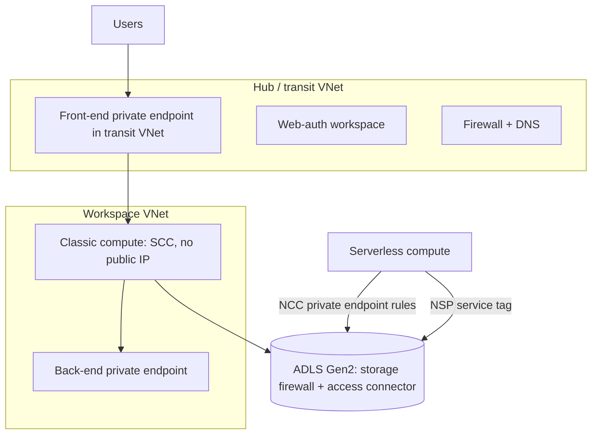

# Azure Databricks: networking and security architecture

Last verified: 2026-10-19. Source: Microsoft Learn `azure/databricks/security/...` pages (ms.date 2026-05-20 to 2026-10-16): `network/deployment-architecture`, `network/classic/vnet-inject`, `network/classic/secure-cluster-connectivity`, `network/concepts/privatelink-concepts`, `network/classic/private-link-standard`, `network/front-end/front-end-private-connect`, `network/classic/udr`, `network/serverless-network-security/*`, `network/storage/firewall-support`, `keys/customer-managed-keys`, `privacy/security-profile`, `network/front-end/ip-access-list-workspace`. Tags: GA/PREVIEW only where the page says so, otherwise `UNVERIFIED`.

## 1. Planes and traffic legs
- **Control plane**: Databricks-managed backend and web app. **Classic compute plane**: VMs in your subscription and VNet, same region as the workspace. **Serverless compute plane**: runs in the Databricks account, same region as the workspace.
- Three legs to secure: inbound (users to Databricks), classic (control plane to classic compute), outbound (serverless to your resources). Control-plane to compute-plane traffic stays on the Microsoft backbone even without SCC.

## 2. Pick a security tier (each adds to the previous)
| Tier | Controls | Choose when |
|---|---|---|
| Managed security | Secure cluster connectivity (SCC) + VNet injection; Private Link optional | Baseline for any production workspace |
| Hardened connectivity | + classic (back-end) Private Link, workspace/account IP access lists, serverless egress control, NCC private endpoints | Regulated data, controlled egress |
| Isolated environment | + inbound (front-end) Private Link incl. performance-intensive services, external firewall | Zero public exposure policies |

All Private Link modes need the **Premium plan**, VNet injection and SCC (serverless outbound via NCC needs Premium only).

## 3. VNet injection (classic compute)
- VNet in the same region and subscription as the workspace; VNet CIDR /16 to /24.
- Two dedicated subnets (container private, host public), each at least /26 recommended (down to /28 allowed, not recommended). Match sizes. Not shareable across workspaces.
- Each node uses 2 IPs (one per subnet); Azure reserves 5 IPs per subnet. **Subnet CIDRs cannot be changed after deployment** (VNet configuration update is PREVIEW; otherwise ask the account team).
- Subnets are delegated to `Microsoft.Databricks/workspaces` and NSG rules are added automatically; do not edit them. Use a unique NSG per workspace. Workspace creator needs Network Contributor (or a custom role with subnet `join/action` and `write`).
- Auto NSG outbound: `AzureDatabricks` tag on 443, 3306, 8443-8451; `Storage` 443; `EventHub` 9093; `SQL` 3306 (phasing out). Inbound 22 and 5557 only if SCC is off. Open 111 and 2049 if you restrict outbound (library installs).
- **After 2026-03-31 new VNets have no default outbound**: new workspaces need explicit egress; a NAT gateway on both subnets is recommended. Existing workspaces unaffected.
- Supported regions: not stated on the fetched page: `UNVERIFIED`.

## 4. Secure cluster connectivity (no public IP)
No open inbound ports, no public IPs on nodes; clusters open an outbound 443 tunnel to the SCC relay. Default on (portal; ARM API 2024-05-01+). Docs say SCC will become mandatory for classic workspaces. Enabling on an existing VNet-injected workspace requires stopping all compute and takes more than 15 minutes. With VNet injection you provide NAT; **do not use an egress load balancer** (port exhaustion). Allowlist relay FQDNs, not IPs. Serverless has no public IPs but does not use SCC.

## 5. Private Link design
| Endpoint / setting | Role | Gotcha |
|---|---|---|
| `databricks_ui_api` | Front-end UI/API and classic back-end | |
| `browser_authentication` | SSO web-auth | **One per region per private DNS zone.** If its host workspace is deleted, web login breaks for all workspaces in that region. Use a dedicated web-auth workspace: public access disabled, NoAzureDatabricksRules, delete lock, no clusters, no `databricks_ui_api` endpoint |
| `general_access` | Custom URL, account-level resources, any-region workspaces | Needs the "Context-Based Ingress: Workspace Private Access Policies" account preview. Custom URLs PREVIEW |
| `service_direct` | Performance-intensive services (for example Zerobus Ingest, Lakebase Autoscaling) | PREVIEW |

| Mode | Public network access | Required NSG rules |
|---|---|---|
| Front-end only | Enabled | AllRules |
| Back-end only | Enabled | NoAzureDatabricksRules |
| Full isolation | Disabled | NoAzureDatabricksRules |

- Hub-spoke is required by Microsoft: transit VNet (hub) holds front-end private endpoints and the web-auth workspace; workspace VNet (spoke) holds the classic private endpoint. Suggested subnets: transit private-endpoint /26 to /25; web-auth workspace /28 or /27; classic private-endpoint /27.
- DNS: private zone `privatelink.azuredatabricks.net` with an A record per workspace and `pl-auth.<region>`; link to transit and workspace VNets, or conditional forwarding in hub-spoke.
- Changing an existing workspace needs all compute stopped and takes more than 15 minutes. Context-based ingress allows the first 200 private endpoints by default; use dry-run first; policy changes take under 10 minutes.

## 6. Firewall and UDR egress (classic)
Service-tag routes (next hop Internet) on both subnets: `AzureDatabricks`, `Storage`, `EventHub`; regional tags allowed (add the paired region where storage is paired). With Private Link the `AzureDatabricks` tag is not needed but metastore, artifact blob, log blob and Event Hubs routes remain. Optional Entra ID tag; open 3306 for the legacy Hive metastore.

## 7. Serverless networking
- **NCC** (network connectivity configuration): account-level and regional. Limits: 20 NCCs per region per account; 100 private endpoints per region across NCCs; 50 workspaces per NCC. Premium and account admin required. After attaching to a workspace wait about 10 minutes and restart serverless compute. Private endpoint rules: unique subresource ID each, PENDING then ESTABLISHED after approval on the Azure resource. Model serving needs `blob`; UC model logging needs `dfs`; SecureConnect needs both. Networking costs are charged. GA/Preview tag not on pages: `UNVERIFIED`.
- **Storage firewall for serverless (breaking change)**: allowlisting serverless subnet IDs no longer works and returns 403. Attach the storage account to a Network Security Perimeter and add an inbound rule with service tag `AzureDatabricksServerless.<Region>`; keep the NSP in Transition mode and public access on "Enabled from selected networks"; **"Secured by Perimeter" breaks serverless**. Non-storage resources: allowlist outbound IPs from `ip-ranges.json` (service=Databricks, type=outbound), PREVIEW, IPs can change as often as every 30 days. Serverless is IPv4 only.
- **Serverless egress control** (network policies): Premium; account-level, one policy per workspace; Full access or Restricted (UC external locations in the same region plus listed FQDNs); dry-run available; always allowed: workspace storage, essential system tables, sample datasets; external model and MCP DNS names must be allowlisted. GA tag not stated: `UNVERIFIED`.

## 8. Workspace storage firewall
Needs Premium, VNet injection, SCC, plus a separate private-endpoint subnet of at least /28; create `dfs` and `blob` private endpoints from each client VNet; endpoint resource group must differ from the managed resource group. **One-way warning: enabling via CLI or PowerShell deletes the existing access connector in the managed resource group**; UC external locations that used it must be remapped, so create a replacement connector first. Cloud Fetch clients need private endpoints; the Fabric Power BI service needs a VNet or on-premises gateway.

## 9. Encryption and compliance
- **CMK** (Premium; Key Vault or Managed HSM): managed services CMK (notebooks, secrets, SQL queries and history, AI/BI dashboards, Genie Agents, Git credentials; new writes only; keep the old key 24 h after rotation; revocation breaks reads/writes after cache expiry), DBFS root CMK (optional double encryption), managed disk CMK (classic compute only, not serverless). Key Vault prerequisites for the DBFS/disk pages: `UNVERIFIED`.
- **Compliance security profile / enhanced security monitoring**: adds the Enhanced Security and Compliance add-on charge. Monitoring gives a CIS Level 1 hardened image, antivirus/file-integrity agents and vulnerability scanning on classic compute only. Profile adds automatic cluster update (permanent once enabled) and TLS 1.2+. Required for C5, CCCS Medium, HIPAA, HITRUST, IRAP, ISMAP, K-FSI, PCI-DSS, TISAX, UK Cyber Essentials Plus. Changes take up to 6 hours. Confidential-computing VMs (DC/EC) are blocked.
- **IP access lists**: Premium; IPv4 only; enforced together with account-level context-based ingress (request must pass both); block lists override allow lists; with SCC the compute plane egress IPs must be allowed or back-end Private Link used or classic clusters cannot launch.

## 10. Anti-patterns
- Subnets sized /28 "to save space", then no room to scale (cannot be changed).
- Putting the web-auth endpoint in a normal workspace that later gets deleted.
- Enabling the storage firewall by CLI without a replacement access connector.
- Setting the storage NSP to "Secured by Perimeter" and breaking serverless.
- Using an egress load balancer with SCC.
- Assuming one network policy covers classic and serverless equally.

## 11. Reference architecture

## 12. Talk track
"We start with SCC and VNet injection, then add Private Link in the order the customer's policy demands. The three things that cannot be undone or are easy to break are subnet sizing, the web-auth workspace, and the storage firewall's effect on the managed access connector, so we design those on day one."
