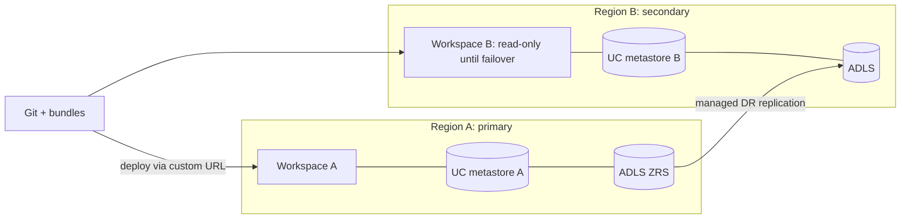

# Azure Databricks: reliability, performance, AI and operations

Last verified: 2026-10-19. Source: Microsoft Learn `azure/databricks/...`: `admin/disaster-recovery` (2026-09-11), `admin/managed-disaster-recovery` (2026-10-14), `compute/photon`, `compute/serverless/limitations` (2026-10-07), `admin/clusters/policies` (2026-09-28), `tables/clustering` (2026-09-25), `optimizations/predictive-optimization` (2026-09-11), `jobs/` and `jobs/repair-job-failures` (2026-10-09), `ldp/`, `machine-learning/model-serving/*`, `ai-search/ai-search` (2026-10-14), `agents/`, `machine-learning/foundation-models/external-models/` (2026-09-23), `ai-gateway/*` (2026-10-08), `dev-tools/ci-cd/*` (2026-10-07), `admin/usage/*`, `admin/account-settings/audit-logs`, `resources/feature-region-support` (2026-10-16). Product naming moved a lot: Delta Live Tables is now Lakeflow Spark Declarative Pipelines, Vector Search is now AI Search, Databricks Asset Bundles are now Declarative Automation Bundles, Delta Sharing is OpenSharing. Check region availability for every feature before a design commitment.

## 1. Disaster recovery
| Concern | Fact |
|---|---|
| Zone failure (HA) | Covers one zone down in multi-zone regions. Control plane recovers automatically in about 15 minutes. Compute-plane AZ resilience is yours: use ZRS or GZRS for root storage (default is GRS) |
| Strategies | **Active-passive** (most common, simplest, cheapest, passive runs nothing) or **active-active** (lowest RPO/RTO, most complex, jobs must succeed in both regions) |
| Default recommendation | Databricks recommends managed DR; DIY only for active-active, cross-cloud, unreplicated resources or fine-grained control |
| Gotchas | GRS does not replicate Databricks root storage reliably: use Delta Deep Clone for managed table data; no production data in DBFS root; DR does not protect against corruption (use Delta time travel); streaming checkpoints must be in customer-managed, replicated storage; workspace URL changes on failover unless you use a stable (custom) URL |
| DIY CI/CD | Deploy jobs to the secondary with concurrency set to 0; pool `min_idle_instances` at 0 until failover |

### Managed DR (apply through your account team; GA/Preview label not stated: `UNVERIFIED`)
- Requires Premium, the **Mission Critical add-on on both workspaces** (higher compute rate), serverless enabled, a metastore in each region, account-level SSO and SCIM or AIM, account admin with ALL PRIVILEGES on the external locations, custom URL plus account-level OAuth.
- Replicated: UC managed Delta tables (data and metadata), external tables and volumes (metadata only), views, functions, grants, notebooks, jobs (arrive paused), SQL warehouses (STOPPED), clusters (TERMINATED), draft dashboards, files, queries, libraries.
- **Not replicated**: materialized views, streaming tables, Lakeflow pipelines, managed volumes, secrets, ML models, serving endpoints, vector search indexes, Delta shares, published dashboards, Structured Streaming outside pipelines.
- Row filters, column masks, ABAC and archival tables are flagged "Failed to replicate" and hold up RPO until removed from scope. Secondary is read-only with no compute; initial asset bootstrap can take up to 5 days; failover takes minutes; post-replication writes can be lost (query RPO via `system.replication.states`). 21 regions supported; region-pair incompatible groups exist (australiaeast/australiasoutheast; eastasia/southeastasia; southcentralus/westus/westus2).

## 2. Compute choices
| Topic | Guidance |
|---|---|
| Photon | On by default for serverless, SQL warehouses and serverless pipelines; classic defaults on but set `runtime_engine=PHOTON` via API. No benefit for queries under 2 s; no UDF/RDD/Dataset acceleration; stateless streaming only |
| Serverless limits | No R; Scala not in notebooks; Spark Connect only; no compute policies, init scripts, instance pools or Spark UI; streaming only `Trigger.AvailableNow`; max runtime 7 days with no retry; notebook default timeout 2.5 h; `createDataFrame` rows capped at 128 MB; UDF memory 1 GB; no `df.cache/persist`; ANSI mode on, UTC; IPv4 only. Use usage policies (Public Preview) to tag serverless usage, not notebook tags |
| Cluster policies | Premium. Editing a policy does not update existing compute (use Enforce; all-purpose enforces on next restart, jobs compute immediately). Adding libraries to a policy removes UI/API-installed libraries on restart. Custom tag colliding with a default tag fails creation. Adding compute to a policy restarts running compute |
| Compute for new jobs/pipelines | See `databricks:databricks-serverless` skill |

## 3. Delta performance
- **Liquid clustering**: GA for Delta (DBR 15.4 LTS+); max 4 keys; not compatible with partitioning or ZORDER; protocol upgrade is irreversible; `CLUSTER BY AUTO` on UC managed tables needs predictive optimization; reclustering existing data needs `OPTIMIZE ... FULL` (DBR 16.4+). In pipelines use `CLUSTER BY`, not `PARTITIONED BY`.
- **Predictive optimization**: runs OPTIMIZE, VACUUM, ANALYZE on UC managed Delta/Iceberg tables; default on for accounts created on or after 2024-11-11; Premium; billed as a serverless jobs SKU; not for external tables or OpenSharing recipient tables; VACUUM retention follows `delta.deletedFileRetentionDuration` (7 days default). Observe via `system.storage.predictive_optimization_operations_history`. GA label not stated: `UNVERIFIED`.

## 4. Jobs resiliency
Limits: 2,000 concurrent task runs per workspace (429 above), 10,000 job creations/hour, 12,000 saved jobs, 1,000 tasks per job. **Repair runs** re-run failed and skipped tasks plus dependents using current settings, only for jobs with 2+ tasks; tasks are not automatically idempotent so repair can duplicate appended data; repair creates a new job cluster. Continuous jobs retry with exponential backoff. Per-task retry limits: `UNVERIFIED`.

## 5. AI on Azure Databricks
| Capability | Facts and limits |
|---|---|
| Model Serving | 1,000 endpoints/workspace; QPS 300,000 with route optimization (200 per workspace without); provisioned concurrency 1,024/model, 4,096/workspace; 16 MB payload (4 MB agents); 597 s execution; Private Link only for provisioned throughput and custom models, and **no Private Link to external endpoints such as Azure OpenAI by default**; many features are cross-geo only in some regions; custom serving not enabled for uksouth workspaces created after 2026-04-30 |
| AI Search (formerly Vector Search) | Standard endpoint about 320M vectors at 768 dims (160M at 1,536; 80M at 3,072); storage-optimized about 1B vectors, no continuous sync; 500 endpoints/workspace, 50 indexes/endpoint, dimension 4,096, 10,000 ANN results (200 hybrid); needs UC and serverless; source needs change data feed for standard; **no row or column-level security**; full-text search is Beta |
| Agent Bricks | Agent developer platform (runtime, durable execution, sandbox, Lakebase memory, MCP tools). Per-feature GA status `UNVERIFIED`; Knowledge Assistant and Supervisor Agent availability by region on the region page |
| External models / Azure OpenAI | `openai_api_type=azure` with API key, or `azuread` with tenant, client ID and secret (scope `https://cognitiveservices.azure.com/`) plus base URL, API version, deployment name. MLflow Deployments CRUD and NCC/Private Link for external models are Public Preview; data may be processed outside the origin region |
| Unity Gateway vs AI Gateway | Unity Gateway governs models, MCP servers and tools (stated generally available), with service policies and budgets. Legacy AI Gateway on serving endpoints still exists (guardrails Public Preview). Unity Gateway is not supported for provisioned throughput, agents or custom-model endpoints; "Block usage" budgets are approximate, not a hard cap |
| MLflow 3 | Logged Models, deployment jobs governed by UC, tracing, evaluation, prompt management. GA label `UNVERIFIED` |

Use the product skills for how-to: `databricks-model-serving`, `databricks-vector-search`, `databricks-agent-bricks`, `databricks-mlflow-evaluation`, `databricks:databricks-unity-gateway`.

## 6. CI/CD with Declarative Automation Bundles
- Azure DevOps: example uses a Microsoft Entra service principal with OAuth M2M secret (`DATABRICKS_HOST`, `DATABRICKS_CLIENT_ID`, `DATABRICKS_CLIENT_SECRET`); steps `bundle validate`, `deploy`, `run`. Secretless options: ARM service connection or Databricks workload identity federation.
- GitHub Actions (page marked Public Preview): `databricks/setup-cli` (pin a version); recommended OIDC workload identity federation with `DATABRICKS_AUTH_TYPE=github-oidc` and `id-token: write`; federation policy subject must match exactly (for example `repo:org/repo:environment:Prod`).
- Targets per environment map to catalog-per-environment (see identity-uc-storage). Use the `databricks-bundles` / `databricks:databricks-dabs` skills for syntax.

## 7. Cost and observability
- `system.billing.usage` holds serverless and classic usage. Budgets: max 4 alerts, 1,000 budgets/account; measured in USD at list price (ignore credits and discounts); email can lag up to 24 h; account admin required.
- Tags: Azure takes at most 50; allowed characters letters, spaces, numbers and `+ - = . _ : / @`; workspace tags take up to 1 h to propagate and need a cluster restart; pool-created clusters do not propagate cluster tags to VMs; colliding custom tags get prefix `x_`. Default tags (Vendor, ClusterId, ClusterName, Creator, RunName, JobId) flow to Azure Cost Management.
- Audit: `system.access.audit` is Public Preview; Azure Monitor diagnostic settings do not cover every service and exclude account-level events; Databricks keeps a copy up to 1 year. Step-by-step Log Analytics delivery setup: `UNVERIFIED`.

## 8. Anti-patterns
- Assuming GRS root storage is a DR plan.
- Putting row filters or ABAC on tables that must replicate under managed DR.
- Counting on serverless for R, Scala notebooks or init scripts.
- Letting VACUUM retention drop below the recovery window.
- One endpoint for every model so one noisy workload exhausts concurrency.
- Skipping the region matrix and discovering the feature is cross-geo only.

## 9. Reference architecture

## 10. Talk track
"Pick the DR approach by cost and complexity: active-passive with managed DR for most customers, with the caveat that pipelines, streaming tables, serving endpoints and secrets are not replicated and must come from code. For performance, serverless first unless a limit blocks you, liquid clustering plus predictive optimization instead of manual tuning."
