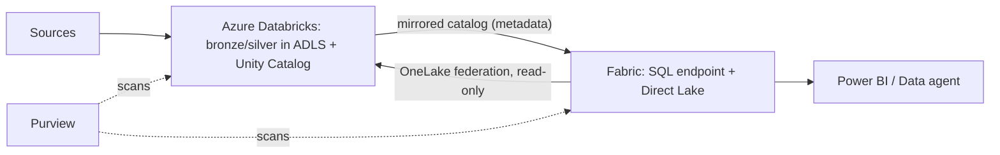

# Fabric architect: Azure Databricks coexistence

Last verified: 2026-10-19 (Learn: `fabric/mirroring/azure-databricks` 2026-10-03, `fabric/onelake/onelake-azure-databricks` 2026-10-13; Databricks docs: `query-federation/onelake` 2026-10-07, `connect/unity-catalog/cloud-storage/external-locations-onelake` 2026-10-08). Azure-specific Databricks architecture (VNet injection, Private Link, Unity Catalog on Azure) is a separate skill, not yet written.

## 1. Four integration patterns
| Pattern | Direction | Status per pages | Best for |
|---|---|---|---|
| **Mirrored Azure Databricks catalog** | Databricks UC to Fabric, metadata only; data read via shortcuts | No GA/preview label: `UNVERIFIED` | Power BI/Direct Lake and SQL users on Databricks-owned tables, no copy |
| **OneLake shortcuts to ADLS** that Databricks writes | Databricks to Fabric, virtualized | Shortcuts page not re-fetched for this use: `UNVERIFIED` | Simple, storage-level sharing |
| **Databricks reads/writes OneLake** (ABFS + service principal; serverless via MSAL + `deltalake`) | Both | No label | Databricks jobs landing into a Fabric lakehouse |
| **UC catalog federation to OneLake** (`CREATE CONNECTION ... TYPE onelake`, foreign catalog) | Fabric to Databricks, read-only | No label: `UNVERIFIED` | Databricks queries over Fabric Lakehouse/Warehouse |
| **UC external location on OneLake** (Azure Databricks Storage item) | Databricks writes managed tables into OneLake | **BETA** | Databricks-managed tables stored in OneLake |

## 2. Key facts per pattern
**Mirrored catalog**: metadata mirror; propagation seconds to minutes; creates a mirrored item plus SQL endpoint; Direct Lake supported; auto-syncs added and removed schemas/tables. Not shown: materialized views, streaming tables, non-Delta external tables.

**Databricks to OneLake (classic compute)**: Spark ABFS OAuth settings with a service principal that has at least Contributor on the Fabric workspace; path `abfss://<workspace>@onelake.dfs.fabric.microsoft.com/<lakehouse>.lakehouse/Files|Tables/...`. **Serverless cannot set those Spark configs** (`CONFIG_NOT_AVAILABLE`): get a token for scope `https://onelake.fabric.microsoft.com/.default` with MSAL and use the Python `deltalake` library with `use_fabric_endpoint: true`. Use one writer per table path. To restrict public access, add the Databricks access connector to the Fabric workspace resource instance rules.

**Catalog federation to OneLake**: read-only; Lakehouse and Warehouse only; DBR 18.0+ standard access mode or SQL warehouse 2025.40+; dedicated access mode not supported; managed identity via access connector (recommended) or service principal (cross-tenant ok). Fabric tenant settings required: "Service principals can call Fabric public APIs", "Allow apps running outside of Fabric to access data via OneLake", "Use short-lived user-delegated SAS tokens", plus workspace setting "Authenticate with OneLake user-delegated SAS tokens". Identity needs workspace Contributor or higher, or Viewer plus item-level Read all ("Read all with SQL analytics endpoint" is not enough). No complex types, views or materialized views.

**UC external location on OneLake (BETA)**: DBR 18.1+ or serverless; needs tenant setting "Users can create Azure Databricks Storage items"; path is ID-based (name-based rejected); supports managed Delta and Iceberg tables, volumes, views, materialized views, streaming tables; no file-event notifications on OneLake paths.

> **Security warning (from the Databricks page):** any principal with Member, Contributor or Admin in that Fabric workspace can read, write and delete the storage item's data, **bypassing Unity Catalog**. Use a dedicated, locked-down workspace.

## 3. Fabric vs Databricks vs both: decision guide
| Question | If yes, lean |
|---|---|
| Heavy ML/GenAI engineering, Unity Catalog already the governance plane, multi-cloud | Databricks owns engineering; Fabric consumes via mirrored catalog |
| Power BI is the main consumer and the team is SQL/low-code | Fabric owns the platform |
| Need one security model | Pick one owner of row/column security; do not rely on two engines enforcing the same intent. OneLake security vs UC row filters/masks are separate systems |
| Cost predictability | Fabric capacity is fixed-price smoothing; Databricks is consumption. Compare with measured workloads, not list prices |
| Regulated data | Keep the system of record in one governed plane, expose a read path to the other |

## 4. Reference architecture

## 5. Anti-patterns
- Two writers to one table path.
- Duplicating gold tables in both platforms "for safety".
- Granting broad Fabric workspace roles on a workspace that holds a Databricks Storage item.
- Assuming UC masks and filters apply to data read through OneLake paths.
- Using serverless Databricks with ABFS Spark configs.

## 6. Talk track
"We do not force a choice. Databricks keeps doing engineering and ML where the team is strong, and Fabric reads the same tables through a mirrored catalog, so BI users never see a copy. The decision we make explicitly is who owns security, because that is where two platforms quietly drift apart."
