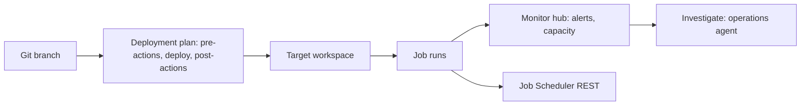

# Fabric architect: deployment plans, Monitor hub and the operations agent

Last verified: 2026-10-21. Source: Microsoft Learn `fabric/cicd/deployment-plan/` (overview, actions, attach, automation), `rest/api/fabric/articles/item-management/definitions/deployment-plan-definition`, `fabric/admin/monitoring-hub` and its jobs, alerts and capacity pages (2026-09 to 2026-10-05), `fabric/real-time-intelligence/operations-agent`, `operations-agent-actions`, `data-factory/operations-agent-for-pipelines`, `operations-agent/fabric-observability-investigation-run`, `rest/api/fabric/core/job-scheduler`. Pages not fetched: Monitor hub Applications and Agents pages, deployment-plan sample/troubleshoot/how-to pages. Hands-on CI/CD steps live in [../../cicd/cicd.md](../../cicd/cicd.md) and the upstream `deployment-pipelines-authoring-cli` and `git-integration-operations-cli` skills.

## 1. Deployment plans (Preview)
**What**: a workspace item that defines **deployment order and pre/post actions** for one deployment operation. It is not run alone: you attach it to a Git update, a deployment pipeline deploy or a supported REST call. It does not change the selected items and does not deploy workspace settings (identities, connections, gateways, Spark settings).

| Concept | Facts |
|---|---|
| Group | Deploys exactly one item; order from `dependsOn`, chained actions and Fabric lineage (file position does not matter); independent groups do not run in parallel; cycles rejected on save |
| Actions | Pre-actions run, then the item deploys, then post-actions. Supported items and job type `Execute`: Notebook, Data pipeline, Dataflow Gen2, Copy job, User data function. A pre-action cannot run the group's own item. Failure stops the operation with **no rollback**; already deployed items stay |
| Variables | Each action has up to 20 parameters; a value is a literal or a Variable library reference; a plan cannot switch the active value set (references resolve against the target workspace's active set) |
| Attachment | Deployment pipelines: choose in the Deploy dialog (default: target-stage plan, or the source-stage plan). Git: Connect and sync, Update from Git, switch branch, branch-out. Commit the plan with the items it references. **`fabric-cicd` does not support plans** |
| Limits | Plan 1 MB; 1,000 groups; 20 pre- and 20 post-actions per group; 20 dependencies and 20 parameters per action; names 60 chars; one plan per operation and one workspace per run; cannot attach to single-item import; same Dataflow Gen2 not in two actions; user data function output over 512 KB truncated |

**API surface (beta, add `?beta=true`)**: the plan travels inside `options` of an existing operation, not as its own run endpoint.
- Update from Git: `POST https://api.fabric.microsoft.com/v1/workspaces/{workspaceId}/git/updateFromGit?beta=true`
- Deploy stage content: `POST https://api.fabric.microsoft.com/v1/deploymentPipelines/{deploymentPipelineId}/deploy?beta=true`
- Bulk import: `POST https://api.fabric.microsoft.com/v1/workspaces/{workspaceId}/items/bulkImportDefinitions?beta=true`
- Body fragment for Git: `{ "options": { "deploymentPlan": { "logicalId": "<plan-logical-id>", "referenceType": "ByLogicalId" } } }`. Pipelines use `"referenceType": "ByItemId"` with `"itemId"` (`referenceType` is case-sensitive).
- Scopes: the original operation's scope **plus `Item.Execute.All`** (for example `Workspace.GitUpdate.All` + `Item.Execute.All`; `Pipeline.Deploy` or `DeploymentPipeline.Deploy.All` + `Item.Execute.All`). A service principal or managed identity works only if every item in the operation supports it.
- Plan as an item: Create Deployment Plan and the generic item get, list, update, delete and definition calls exist (paths not fetched: `UNVERIFIED`). Definition parts: `plan.yml` (required) and `.platform`, `InlineBase64`.

```yaml
$schema: https://developer.microsoft.com/json-schemas/fabric/item/deploymentPlan/definition/plan/1.0.0/schema.json
version: 1.0.0
groups:
  - name: group1
    logicalId: <logical-id-1>
    preActions:
      - name: preAction1
        job: { type: Execute, logicalId: <notebook-logical-id> }
  - name: group2
    logicalId: <logical-id-2>
    dependsOn:
      - groupName: group1
```
Item-management table has no Deployment plan row, but the definition page exists. Git and deployment pipelines tag Deployment plan preview.

**Use when**: a medallion promotion needs ordered steps (for example run the bronze notebook before deploying silver items) that deployment pipelines alone cannot express. **Do not use when**: you rely on `fabric-cicd` for promotion, or need rollback.

## 2. Monitor hub (Preview)
Redesigned hub with Job runs (one row per job, last 5 run history per item; statuses In progress, Succeeded, Failed, Canceled), Alerts, Capacity, Applications and Agents (the last two `UNVERIFIED`).
- **Alerts**: free "Schedule failure emails" (not for manual runs or semantic models) and paid Activator-based alerts (Started/Succeeded events and actions; workspace Owner or Contributor, workspace monitoring enabled).
- **Capacity**: health tiles (Healthy, At risk, Degraded, Paused), CU %, throttling, surge protection; actions pause, resize, reassign workspaces, set overage limit; needs Fabric or capacity admin (resize needs the Azure subscription owner).
- Permissions: any user sees only items they may view. Retention: not stated. No API for the hub itself.
- **Programmatic equivalent**: Job Scheduler REST. `GET https://api.fabric.microsoft.com/v1/workspaces/{workspaceId}/items/{itemId}/jobs/instances` (scope `Item.Read.All` or item-specific); most items keep 100 recent completed instances; statuses NotStarted, InProgress, Completed, Failed, Cancelled, Deduped; returns `failureReason`; 429 carries `Retry-After`. Use it to build run-history reports; use the hub for humans.

## 3. Operations agent (Real-Time Intelligence item)
| Topic | Facts |
|---|---|
| Status | **Operations agent for pipelines: Preview**; observability investigation: Preview; investigator insights: Preview; core overview and actions pages carry no label (`UNVERIFIED`) |
| Prerequisites | Fabric-enabled capacity (**trial not supported**), an eventhouse (KQL database) or an ontology in the workspace, Microsoft Teams, tenant settings for operations agent, Copilot and Azure OpenAI (plus cross-geo processing if the capacity is outside US/EU) |
| Behaviour | Runs as the creator (OBO) with an Entra Agent ID; rules evaluate every 5 minutes (state and transition conditions); default action is a Teams message; actions can run notebooks, pipelines, UDFs and Power Automate flows |
| Pipelines variant | Health monitoring only; start from the pipeline Home ribbon; the **Investigate** action on a failed run in Monitor hub opens a read-only investigation (needs workspace monitoring enabled and Contributor; chat state clears on refresh; runs that failed before monitoring was enabled are not captured) |
| Mechanisms | Portal; REST and Git support `NOT FOUND` (listed as a Data Factory item with *(preview)* in deployment pipelines). Billing meter `NOT FOUND` |

The upstream `azmon-mirroredcatalogs-operations-cli` skill generates instruction blocks for an operations agent over Azure Monitor data that the user pastes into Fabric.

## 4. Reference flow



## 5. Anti-patterns
- Assuming a plan rolls back on failure.
- Expecting a plan to switch the Variable library value set.
- Promoting with `fabric-cicd` and expecting plans to apply.
- Leaving workspace monitoring off and then expecting investigations to work.
- Treating Activator-based alerts as free (the failure email is the free one).
- Forgetting `Item.Execute.All` on the token.

## 6. Talk track
"A deployment plan is the order of operations for a release: run this notebook, deploy these items, then run that pipeline. It rides on the normal deployment, it does not roll back, and it is preview. For operations we use the Monitor hub for people and the Job Scheduler API for reports, with the operations agent for first-line investigation of pipeline failures."
