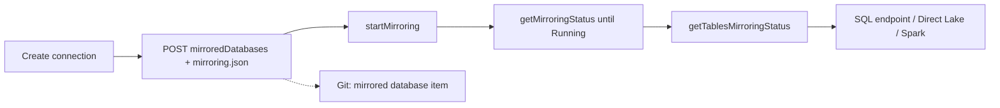

# Fabric architect: building mirroring with the REST API

Last verified: 2026-10-21. Source: Microsoft Learn `fabric/mirroring/mirrored-database-rest-api` (2026-03-23), `mirrored-database-definition` and `create-mirrored-database`, `start-mirroring`, `get-mirroring-status` REST pages, `mirroring/extended-capabilities` (2026-06-24), `mirroring/overview` (2026-08-28), `mirroring/google-bigquery` (2026-08-28). Pages not fetched: stop mirroring, get tables status, get/update definition reference pages, BigQuery security and cost pages. The shortcut-versus-mirror decision is in [onelake-integration.md](onelake-integration.md); this file covers the build path. The REST pages **do not apply to mirrored databases from Azure Databricks** (use the mirrored catalog item, see [databricks-coexistence.md](databricks-coexistence.md)).

## 1. When to build mirroring by API
Use REST (or Terraform/CI/CD later) when you need repeatable environments, many sources, or tests in a PoC pipeline. Use the portal for a first demo. Open mirroring (landing zone in OneLake) is the path for sources Fabric does not support natively.

## 2. Endpoints (base `https://api.fabric.microsoft.com/v1`)
| Operation | Verb and path | Notes |
|---|---|---|
| Create | `POST /workspaces/{workspaceId}/mirroredDatabases` | Definition required; scopes `MirroredDatabase.ReadWrite.All` or `Item.ReadWrite.All`; contributor workspace role; returns 201 or 429 with `Retry-After`; errors include `ItemDisplayNameAlreadyInUse`, `CorruptedPayload`, `WorkspaceItemsLimitExceeded` |
| Get / List / Delete | `GET`/`DELETE .../mirroredDatabases[/{id}]` | |
| Update metadata | `PATCH .../mirroredDatabases/{id}` | displayName, description |
| Get / update definition | `POST .../{id}/getDefinition`, `POST .../{id}/updateDefinition` | Source connection, database and `defaultSchema` can change only while status is Initialized or Stopped |
| Start | `POST .../{id}/startMirroring` | Cannot start while Initializing; needs read and write on the item |
| Stop | `POST .../{id}/stopMirroring` | Scopes: not on the fetched pages (`UNVERIFIED`) |
| Status | `POST .../{id}/getMirroringStatus` | Values: Initializing, Initialized, Starting, Running, Paused, Stopping, Stopped |
| Table status | `POST .../{id}/getTablesMirroringStatus` | Only when status is Running; per table status plus `processedBytes`, `processedRows`, `lastSyncDateTime` |

Callers can be a user, service principal or managed identity.

## 3. Definition (`mirroring.json`, base64 in `parts[]`)
```json
{
  "properties": {
    "source": {
      "type": "<source type>",
      "typeProperties": { "connection": "<connection-id>", "database": "<database>" }
    },
    "target": {
      "type": "MountedRelationalDatabase",
      "typeProperties": { "defaultSchema": "<schema>", "format": "Delta" }
    }
  }
}
```
- Source type values: `AzureMySql`, `AzurePostgreSql`, `AzureSqlDatabase`, `AzureSqlMI`, `CosmosDb`, `GenericMirror`, `GoogleBigQuery`, `MSSQL`, `Oracle`, `SAP`, `SharePointList`, `Snowflake`, `SqlServer2025`.
- `database` is documented as required only for Snowflake and CosmosDb. Source-specific JSON for Azure SQL, Cosmos DB and BigQuery is **not shown** on the pages (`<your source type>` placeholder): do not invent it; export a portal-created mirror with `getDefinition` and reuse its shape.
- Snowflake adds `externalStorages` (for example an `AmazonS3` connection); SAP uses `subType: Datasphere` plus a `landingZone` (Lakehouse).
- Select tables with `mountedTables: [{"source": {"typeProperties": {"schemaName": "...", "tableName": "..."}}}]`. If omitted, all tables mirror and new tables are added automatically.
- `target.typeProperties.retentionInDays` accepts 1 to 30. **Default conflict**: REST pages say 7; the overview says 1 for portal-created mirrors after mid-June 2025 (7 for older). Set it explicitly.
- `target.typeProperties.enableDeltaChangeDataFeed: true` enables CDF (get the definition, add the property, `updateDefinition`).
- Set `defaultSchema` to preserve the source schema hierarchy.

```bash
TOKEN=$(az account get-access-token --resource https://api.fabric.microsoft.com --query accessToken -o tsv)
curl -s -X POST "https://api.fabric.microsoft.com/v1/workspaces/<workspace-id>/mirroredDatabases/<id>/startMirroring" \
  -H "Authorization: Bearer $TOKEN" -H "x-ms-fabric-skill: microsoft-fabric"
```
(The `x-ms-fabric-skill` header is the upstream telemetry convention; keep it consistent with the other skills.)

## 4. Prerequisites per source (as the pages state)
- Azure SQL Database, SQL MI, Azure Database for PostgreSQL, Azure Database for MySQL, SQL Server 2025: enable the server's managed identity and grant it Read and Write on the mirrored database (portal), or use the Add Workspace Role Assignment API.
- Google BigQuery: GA; permissions are on a page not fetched (`UNVERIFIED`); Google-side CDC compute, Storage Write API and storage are billed by Google.
- Cosmos DB: NoSQL API only, continuous backup required, no multi-write accounts (see the Cosmos skill).
- All: a running Fabric capacity is required (paused or deleted capacity stops replication); free mirroring storage 1 TB per CU purchased; changes can publish as fast as every 15 seconds.

## 5. Status labels (note the conflicts)
| Feature | Learn status |
|---|---|
| Mirroring for Google BigQuery | **GA** (overview and BigQuery page agree) |
| Azure Database for MySQL, Dremio catalog, SharePoint List mirroring | "(preview)" in the overview table (whats-new, read only as a summary, lists SharePoint List as GA: conflict) |
| Delta change data feed | **Preview** (extended-capabilities); keynote said GA, whats-new summary lists "Extended mirroring capabilities" GA: conflict |
| Mirroring views | **Preview**, "only supported in preview in mirroring for Snowflake" |
| Source security-role handling | Snowflake security-role mirroring Preview; handling for mirrored views `NOT FOUND` |
| REST API page | No status label |
| Extended capabilities billing | Core mirroring is free; extended capabilities (CDF, views) are paid and usage based |

## 6. Reference flow



## 7. Anti-patterns
- Writing source JSON from memory instead of exporting a working definition.
- Leaving `retentionInDays` at an assumed default.
- Enabling CDF or views in a regulated PoC without checking they are preview and billed.
- Mirroring a multi-write Cosmos account (unsupported) or relying on mirroring while the capacity is paused.
- Using these endpoints for an Azure Databricks mirrored catalog.

## 8. Talk track
"We build the mirror from code so it is repeatable: create the item with a definition, start it, and watch table status until it is replicating. I will tell you which pieces are GA, such as BigQuery, and which are preview, such as change data feed and views, before we put them in a plan."
