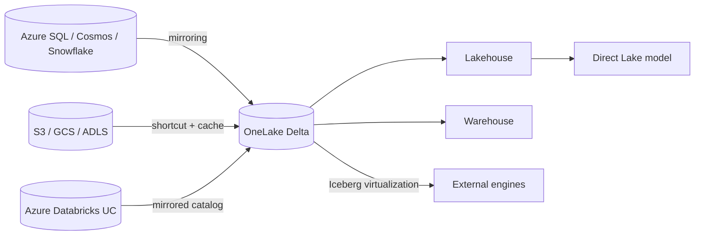

# Fabric architect: OneLake integration and migration

Last verified: 2026-10-19 (Learn: `onelake/onelake-shortcuts` 2026-07-13, `mirroring/overview` 2026-08-28, `onelake/onelake-iceberg-tables` 2026-07-30, `onelake/onelake-consumption` 2026-09-21, `fundamentals/migration` 2026-04-07, `data-factory/upgrade-planning-azure-data-factory` 2026-10-05, `data-engineering/migrate-synapse-overview` 2026-04-28).

## 1. Shortcut vs mirror vs copy

| Choose | When | Not when |
|---|---|---|
| **Shortcut** | Data stays in place in an open format, owned by another team or cloud; no ETL; live reads | Source cannot take the query load; you need isolation from source outages; need transformation on landing |
| **Mirroring** | Operational database needs near-real-time Delta in OneLake, managed CDC, no pipelines | Source unsupported; you need custom transforms; scheduled batch is enough |
| **Metadata mirroring** (Databricks, Snowflake) | You want catalog visibility with no data copy | You need data physically in OneLake |
| **Copy** (pipeline, Copy job, Dataflow) | Transform on landing, unsupported source, schedule not continuous, isolation from source | Simple read-in-place would do |

## 2. Shortcuts
- Sources: internal (Lakehouse, KQL DB, Warehouse, SQL database, mirrored DB, mirrored Databricks catalog, semantic model) and external (ADLS Gen2, Blob, S3, S3-compatible, GCS, Dataverse, Iceberg, OneDrive/SharePoint). On-prem and network-restricted via on-premises data gateway.
- Auth: internal shortcuts use the caller's identity. External use cloud connections. **Direct Lake over SQL and T-SQL in delegated mode pass the item owner's identity**, not the caller's; use Direct Lake on OneLake or user-identity mode when per-user security matters.
- Cache (GCS, S3, S3-compatible, gateway): 1 to 28 days retention, files over 1 GB not cached, workspace-level setting. Cuts cross-cloud egress.
- Limits: 100,000 shortcuts per item; 100 unique external connections per item; 10 shortcuts per OneLake path; max 5 shortcut-to-shortcut hops; no `%` or `+` in names; shortcuts in Tables only at top level.
- Deleting a shortcut leaves the target. Deleting *files inside* a shortcut deletes them in the target if you have write permission.
- Consumer capacity pays the transaction CUs; source capacity pays storage only and can be paused without breaking consumers. External providers bill egress. Cross-region charge for internal shortcuts: `UNVERIFIED`.

## 3. Mirroring
- Database mirroring: Cosmos DB, Azure DB for PostgreSQL, Azure SQL DB, SQL MI, SQL Server, Snowflake, Oracle, Google BigQuery (called GA), SAP, Fabric SQL database. PREVIEW per page: Azure DB for MySQL, SharePoint List. Open mirroring: landing zone in OneLake, public API. Build path (REST, definition JSON, status values): [mirroring-build.md](mirroring-build.md). Status conflicts (Learn 2026-10-21): Delta change data feed and mirroring views are Preview on `extended-capabilities` (views: Snowflake only) while a whats-new summary lists them GA; SharePoint List is "(preview)" on the overview but GA on whats-new. Other per-source GA status and limits: `UNVERIFIED`.
- Cost: replication compute is free and uses no CUs; free mirroring storage is 1 TB per CU purchased (F64 gives 64 TB); beyond that, or while the capacity is paused, normal OneLake rates. A running capacity is required or replication stops. Queries are billed normally.
- Latency: changes can publish as fast as every 15 seconds; real latency depends on region, volume, bandwidth, gateway. No SLA stated.
- Default vacuum retention 1 day for portal-created mirrors after mid-June 2025 (7 days older), configurable via `retentionInDays`.
- Mirrored DBs get a SQL endpoint, cross-database queries, Direct Lake, and RLS/OLS.
- **Cosmos DB mirroring** (`mirroring/azure-cosmos-db` 2026-10-06): NoSQL API only; needs continuous backup (7-day tier is free and recommended); replication uses no RUs; does not use analytical store or change feed; not for multi-write accounts; no OneLake CMK; nested data lands as JSON strings (use `OPENJSON`); Entra RBAC needs `readMetadata` and `readAnalytics`; private-endpoint accounts via VNet data gateway and trusted workspace access; not in sovereign clouds. **Synapse Link for Cosmos DB is not supported for new projects; Learn says use Fabric mirroring.**

## 4. Delta and Iceberg interop
- Two-way metadata virtualization: Delta to Iceberg (virtual V2 metadata) and Iceberg to Delta (Iceberg shortcut). Parquet only. Iceberg V2 supported; V3 partial (deletion vectors yes; variant, geo, ns-timestamp dropped).
- Source tables need fewer than 5,000 commits; conversion takes 5 s to 2 min, so update less often than every 2 min.
- Iceberg shortcuts must sit directly under Tables of a non-schema-enabled lakehouse. Not supported with private links. OneLake shortcut targets must be in the same region. Unavailable in Qatar Central and Norway West.
- Iceberg-to-Delta gaps: no column renames; only identity and year/month/day/hour partition transforms; equality deletes fail; absolute paths make copies non-portable.
- Use `IcebergCompatV2`, or `IcebergCompatV3` with deletion vectors.

## 5. Migration playbooks
| From | Path | Notes |
|---|---|---|
| **ADF** | (1) Mount an ADF item (live view, execution still in Azure), (2) built-in assessment-first upgrade (Ready / Needs review / Coming soon / Not compatible), (3) manual rebuild | Datasets become inline properties; global parameters become Variable Libraries; SHIR becomes OPDG; VNet IR becomes VNet data gateway; linked services become Connections; scheduling per pipeline; CDC becomes Copy job; SSIS stays in ADF; Mapping Data Flow to Dataflow Gen2 is PREVIEW |
| **Synapse Spark** | Copy-and-adapt (not in-place); Spark Migration Assistant, 4-phase series | Notebooks, SJDs, pools, libraries, HMS metadata. See `synapse-migration` skill |
| **Synapse dedicated SQL pool** | Migration Assistant for Fabric Data Warehouse exists | Content not fetched: `UNVERIFIED` |
| **Synapse Data Explorer / ADX** | Eventhouse | Synapse DE to Eventhouse is PREVIEW |
| **HDInsight, Power BI Premium** | No dedicated pages on the index | `UNVERIFIED`; see `hdinsight-migration` skill |
| **Azure Databricks** | Coexist, do not migrate by default | See [databricks-coexistence.md](databricks-coexistence.md); `databricks-migration` skill covers notebook porting |

## 6. Reference architecture

## 7. Anti-patterns
- Copying data nightly that a shortcut could expose live.
- Shortcutting to a source that cannot take BI query load.
- Assuming mirroring is free after 1 TB per CU or while the capacity is paused.
- Mirroring a multi-write Cosmos account (unsupported).
- Treating Synapse Link as a strategic choice for new work.

## 8. Talk track
"Read in place with a shortcut when you can, mirror when the source is an operational database that needs to be analytics-ready, and copy only when you must transform or isolate. That order minimizes pipelines, storage and risk."
