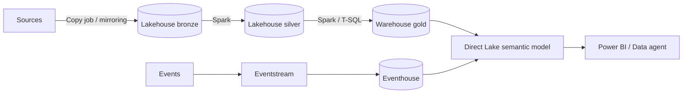

# Fabric architect: workload selection

Last verified: 2026-10-19 (Microsoft Learn: `fundamentals/decision-guide-data-store` 2026-09-15, `data-warehouse/data-warehousing`, `fundamentals/decision-guide-pipeline-dataflow-spark`, `fundamentals/direct-lake-overview` 2026-09-02). Tags: GA unless noted.

## 1. Data store decision matrix

| Need | Pick | Why | Do not pick when |
|---|---|---|---|
| Big data, ML, unstructured and semi-structured, PySpark | **Lakehouse** | Delta on OneLake, Spark-first, SQL analytics endpoint is read-only for data | Team is T-SQL only and needs DML or multi-table transactions |
| Enterprise DW, star schema, T-SQL, multi-table transactions | **Warehouse** | Full DDL/DML, no-knobs performance | Mostly raw files and Spark transforms |
| Streaming events, logs, telemetry, time-series, KQL | **Eventhouse** | High-granularity interactive analytics. OneLake availability is opt-in here only | Simple batch BI |
| OLTP, normalized relational, app back end | **SQL database in Fabric** | Azure SQL engine; auto-replicated to OneLake with a SQL endpoint | Heavy analytical scans on the same engine |
| NoSQL, JSON, global low-latency | **Cosmos DB** (Azure, or Cosmos DB in Fabric) | See the Cosmos skill when created | Relational joins dominate |

Tiebreakers from Learn: team skill set and the need for multi-table transactions. A lakehouse suits mixed PySpark and T-SQL teams where the T-SQL users only read.

Both Warehouse and the lakehouse SQL endpoint use the same T-SQL engine and support three-part-name cross-database queries.

## 2. Ingestion and transformation tool choice

| Tool | Best for | Transform level |
|---|---|---|
| Copy activity | Bulk ingestion and migration, up to petabyte scale (50+ sources) | Light |
| Copy job | Incremental, CDC and replication wizard; supports on-prem gateway | Light |
| Dataflow Gen2 | Power Query, low to medium volume (150+ connectors) | 300+ functions |
| Eventstream | Event ingestion, medium to high volume | Light |
| Spark notebook | Code-first, complex or large transforms | Full |

## 3. Semantic model storage mode

| Mode | Use when | Watch out |
|---|---|---|
| **Direct Lake on OneLake** | Default for large Delta-backed models; reads Delta from one or more Fabric items including shortcuts | Never falls back to DirectQuery, so guardrail breaches fail refresh. SQL-endpoint RLS/OLS not applied. Non-materialized SQL views not supported as sources |
| **Direct Lake on SQL endpoint** | Single source behind a SQL endpoint | Falls back to DirectQuery on SQL views, SQL RLS, or unprocessed tables. Fallback is controlled by the model's "Direct Lake behavior" property |
| **Import** | Small data, complex DAX, any licence | Refresh cost and latency |
| **DirectQuery** | Need live source, small result sets | Slow at scale; source load |
| **Composite** | Mix Direct Lake on OneLake with Import tables | Do not mix Direct Lake on SQL endpoint with DirectQuery/Dual |

Direct Lake needs an F or P capacity (Import/DQ work on any licence).

### Direct Lake guardrails per SKU (breach = failure or fallback)
| SKU | Files/table | Row groups/table | Rows/table (M) | Model size on disk | Memory (GB) |
|---|---|---|---|---|---|
| F2-F8 | 1,000 | 1,000 | 300 | 10 GB | 3 |
| F16 | 1,000 | 1,000 | 300 | 20 GB | 5 |
| F32 | 1,000 | 1,000 | 300 | 40 GB | 10 |
| F64 | 5,000 | 5,000 | 1,500 | unlimited | 25 |
| F128 | 5,000 | 5,000 | 3,000 | unlimited | 50 |
| F256 | 5,000 | 5,000 | 6,000 | unlimited | 100 |
| F512 | 10,000 | 10,000 | 12,000 | unlimited | 200 |
| F1024+ | 10,000 | 10,000 | 24,000 | unlimited | 400 |

Max memory is not a hard guardrail: beyond it, queries page and slow down.

### Table layout for Direct Lake
- V-Order, 1M to 16M rows per row group; avoid many tiny row groups.
- Prefer append plus regular `OPTIMIZE`; overwrite and update/delete patterns force cold reloads.
- Partition only on low-cardinality columns (fewer than about 100 to 200 values).
- Do not `VACUUM` away the Delta version the model is framed to.

## 4. Fabric vs Azure Databricks vs Synapse (decision guide)

| Situation | Lean toward |
|---|---|
| Microsoft-centric estate, Power BI heavy, SaaS simplicity, mixed skill levels | **Fabric** |
| Existing Databricks investment, advanced ML, Unity Catalog governance, multi-cloud | **Azure Databricks** (see `databricks-coexistence.md`) |
| Both: Databricks engineering, Fabric BI | **Both**, joined by mirroring or shortcuts |
| Dedicated SQL pool or Synapse Spark today | **Migrate to Fabric** (see `onelake-integration.md`), do not start new Synapse work |

`UNVERIFIED`: Microsoft Architecture Center comparison page was not found; treat the table as guidance, not a Microsoft statement.

## 5. Anti-patterns
- One giant workspace and one capacity for dev, test, prod and ad-hoc.
- Using a lakehouse SQL endpoint for write-heavy T-SQL ETL.
- Direct Lake on a table with thousands of tiny files and no `OPTIMIZE`.
- Relying on SQL RLS with Direct Lake on SQL endpoint and then wondering why it falls back to DirectQuery.
- Choosing Eventhouse for a batch star schema because it is fast.

## 6. Reference architecture

## 7. Talk track
"We separate by access pattern, not by team preference. Files and Spark live in a lakehouse, governed star schemas live in a warehouse, event streams live in an eventhouse. Everything lands in OneLake as Delta, so the semantic model reads it with Direct Lake and nobody copies data twice. The one thing to watch is the Direct Lake guardrails for your SKU."
